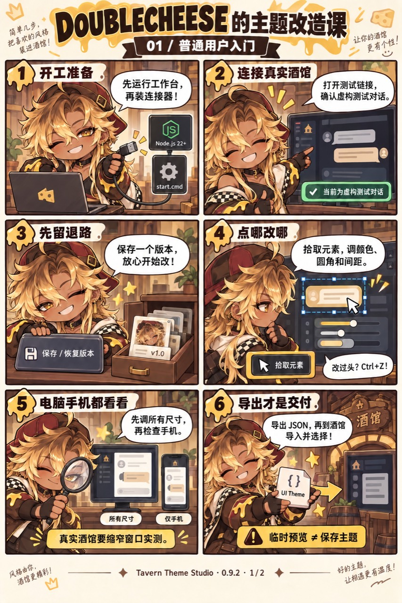

# 酒馆主题工作台 · Tavern Theme Studio

**和 Agent 从一个想法做出美化，在真实酒馆里边看边改。** 从认识界面、看图讨论方向开始，逐步完成原生主题；也可以直接调整现有主题的颜色、圆角、间距和装饰。满意后直接应用到酒馆，或下载主题 JSON 分享。

当前版本 **0.11.0** · Windows 双击启动 · 已实测 SillyTavern **1.19.0 / 06bde939f** · [MIT 代码许可](LICENSE)

**Windows：双击 `start.cmd` 安装并启动，双击 `update.cmd` 更新后启动。** 首次选择一次酒馆目录，之后自动同步连接器；缺少 Node 时自动准备便携运行环境。详见 [一键安装与更新](docs/install-update.md)。

编辑沿用原来的拾取和属性面板，支持透明度、四边间距、手机半屏编辑与直接应用到酒馆；见 [直接编辑指南](docs/direct-editing.md)。

[下载核心安装包](https://github.com/demilich1117/tavern-theme-studio/releases/latest) · [浏览源码](https://github.com/demilich1117/tavern-theme-studio) · [自动检查](https://github.com/demilich1117/tavern-theme-studio/actions/workflows/ci.yml)

普通用户下载 [0.11.0 核心安装包](https://github.com/demilich1117/tavern-theme-studio/releases/download/v0.11.0/tavern-theme-studio-0.11.0-core.zip)，完整解压后双击 `start.cmd`；不必下载 GitHub 自动生成的 Source code 压缩包。校验文件和更新说明见 [v0.11.0 Release](https://github.com/demilich1117/tavern-theme-studio/releases/tag/v0.11.0)。以后双击 `update.cmd` 获取更高版本的正式安装包；Git 克隆的源码目录通过快进合并更新。

电脑上运行工作台，酒馆里安装连接器。日常入口是「作品」「编辑」「素材」「修改意见」；还没有设计方案时，打开「从零共创」。在「作品」继续编辑、保存定稿或打开作品文件夹，详见 [固定作品目录](docs/work-folders.md)。

## 选一条路线

| 你想做什么 | 从这里开始 |
| --- | --- |
| 只有想法，想和 Agent 一起设计自己的美化 | [从零共创](#co-design) → [完整共创指南](docs/co-design.md) |
| 第一次使用，先改颜色、字号或间距 | [普通用户入门](#beginner) |
| 整理素材、调整图层，或让 AI 帮忙改主题 | [进阶使用](#advanced) → [完整进阶指南](docs/advanced-guide.md) |
| 先看图，跟着 DOUBLECHEESE 学 | [三页漫画说明](docs/comic-guide.md)，从零设计先看 [共创篇](docs/comic-guide.md#page-3) |
| 维护源码、检查或制作发行包 | [开发与发布](docs/release.md) |

入门和进阶是**同一个工作台的两种使用路线**，不需要另装「进阶版」。

<a id="co-design"></a>

## 从零与 Agent 共创

不用先有成品主题，也不用先懂 CSS 或安装工作台。可以直接和 Agent 聊；工作台在制作样板时提供真实酒馆预览、部件定位和微调。已经启动工作台时，**「从零共创」** 能帮你把想法和当前工程一起带给 Agent。

1. **聊想法。** 例如「暗黑童话，手机为主，布局可以大改」。直接对 Agent 说即可；也可在「从零共创」里点 **「复制给 Agent，开始共创」**，粘贴到已打开本项目的 Agent 对话。有参考图时另附图片。
2. **看图，说喜欢哪里。** Agent 先认识酒馆原生部件，再给出构图、排版和装饰有实质区别的方向。你直接说「喜欢 A 的书页感，装饰少一点」即可，布局也可以大胆重做。
3. **试样板，边看边改。** 大方向敲定后，Agent 尽量照选定参考图制作，落实布局、头像和消息形态，用真实截图对照后接入工作台供你试用。你用「拾取元素」微调字号、间距等，用「标点评论」指出要改的地方，或直接在对话里提意见。Agent 接着完善，满意后点「应用到酒馆」。

**设计记录、接入预览和检查交给 Agent；用户只需说想法、看图和试效果。** 已在同一项目对话里，标注后告诉 Agent「标好了」即可；首次或换 Agent 时再复制交接。工作台不会自行启动 AI 或监听对话，参考图片需另附。

起步想法会留在当前浏览器，需要时可展开「想法怎么保存？」下载；Agent 另外维护设计记录，两者不会自动同步。换对话时，把 Agent 整理的记录和参考图带过去即可。已有明确参考可以缩短探索，小幅修补可直接编辑。更多说明与 Agent 制作规范见 **[从零共创指南](docs/co-design.md)**。

<details>
<summary>看六格漫画：DOUBLECHEESE 带你从想法做到原生主题</summary>


[打开共创篇原图与文字步骤](docs/comic-guide.md#page-3)

</details>

<a id="beginner"></a>

## 普通用户入门

第一次的目标很简单：**连上酒馆 → 拾取微调 → 应用到酒馆。**

### 1. 启动工作台

先保持酒馆运行，完整解压工作台到一个固定文件夹。**Windows 直接双击 `start.cmd`**：运行环境、依赖和连接器都会自动准备，不需要先敲命令或手工安装 Node。

首次会弹出目录选择框，选择你的 **SillyTavern 文件夹**（包含 `server.js`）；只有多用户酒馆才需要再选一次使用的用户。完成后自动打开专用测试页，以后会记住位置。使用期间保持启动窗口开启。

macOS / Linux 或偏好命令行时，准备 Node.js 22+，在源码目录运行：

```powershell
npm ci --omit=dev
npm run setup
```

核心包已含依赖，可直接 `npm run setup`。传统的 `npm start` / `npm run lab` 仍可使用，连接器手动安装方式如下。

### 2. 给酒馆安装连接器

**通过 `start.cmd` 或 `npm run setup` 启动时，这一步已自动完成。** 只有手动部署连接器时才需要下面的操作；源码用户先运行 `npm run package:connector`。

<details>
<summary>手动安装连接器</summary>

将整个 `tavern-theme-studio-connector` 文件夹放入酒馆的 `data/<用户名>/extensions/`。核心包用户先解压 `dist/tavern-theme-studio-connector.zip`；源码用户使用刚生成的 `dist/tavern-theme-studio-connector/`。

安装后应是下面的层级，**不要多套一层同名目录**：

```text
SillyTavern/
└─ data/<用户名>/extensions/
   └─ tavern-theme-studio-connector/
      ├─ manifest.json
      ├─ connector/
      └─ shared/
```

刷新或新开一个酒馆标签，在「扩展」面板确认出现「主题工作台」。

</details>

### 3. 进入专用测试对话

打开启动终端打印的 **`#tts-lab` 链接**，等待工作台显示 **「当前为虚构测试对话」**。这是用来检查主题的专用样本，包含普通消息、长文、思考栏、代码、表格和图片。

默认酒馆地址是 `http://127.0.0.1:8000`，工作台是 `http://127.0.0.1:19323`。酒馆地址不同的设置方法见 [真实酒馆工作流](docs/native-lab.md)。

也可以从酒馆「扩展 → 主题工作台」选择「在新标签打开测试工作台」。连接问题先看 [常见问题](#faq)。

### 4. 选好作品，改一处样式

在「作品」打开已有作品；想改另一份美化，用「新建作品」接入酒馆当前主题或导入主题 JSON。从零开始则选「从空白开始」，只需填写名称，工作台会准备好独立目录、基础主题和源码同步。

每件作品独立保存，切换前自动留恢复点。平时的修改会自动保存；大改前也可在「备份 → 保存 / 恢复版本」手动留一个快照。

接下来试着把角色消息改得更舒服：

1. 点击「拾取元素」，再点击消息正文、头像或引用等目标部件。想改整块消息背景，可在「选择编辑对象」中选择「角色消息」。
2. 调整背景颜色、圆角或内边距，在真实酒馆里观察效果。
3. 勾选「查看原样」比较前后，取消勾选继续预览。
4. 不满意就 `Ctrl+Z` 撤销；颜色、数值旁的还原按钮可只还原这一项。

拾取的是一个部件，规则会作用于**同类部件**。对象旁边可直达相关内外层部件和已接入的装饰；未支持的位置会提示继续选择。暂时看不到的部件，先在酒馆里展开它再拾取；`Esc` 可取消拾取。

数值可以拖动或直接输入；颜色保留透明度，内边距需要时再展开「分别调整四边」。属性下方会显示实际生效状态。

### 5. 再看一眼手机效果

先在「所有尺寸」中调整基础样式；需要单独照顾窄屏时再切到「仅手机」，默认作用于宽度不超过 **767 px** 的画面。

连接真实酒馆时，要缩窄**酒馆窗口**检查效果。示例预览的「手机」按钮只改变示例尺寸。手机默认用底部半屏面板，拖动顶边可调整高度；拾取后会自动定位编辑区，也可收起面板查看完整阅读区。

### 6. 应用到酒馆，或下载分享

1. 点击「应用 / 导出」，确认主题名称；默认会附上时间，避免覆盖原主题。
2. 点击「应用到酒馆」。如果酒馆弹出导入提示，按提示完成。
3. 等待「已保存并应用」后即可关闭工作台，主题效果会保留。

需要分享文件，或当前连接器没有直接应用入口时，点「下载酒馆主题 JSON」，再到酒馆「用户设置 → UI Theme」导入并选择。遇到同名提示时换一个新名称。

**临时预览和自动保存草稿不会更改酒馆保存的主题。** 「应用到酒馆」成功后才会持久生效；继续微调也不会自动覆盖已经应用的版本。

普通导出会把本地图片放进 JSON，保留原有图片和字体外链；含外链的主题仍需要网络。

### 下次接着改，应该存什么？

| 保存方式 | 用途 |
| --- | --- |
| **保存定稿** | 在「作品」保留工程微调、主题成品、素材和绑定源码，可查看历史或下载当时的主题 |
| **主题 JSON** | 导入酒馆、分享最终效果 |
| **工程备份 `.studio.json`** | 搬走当前工程与本地素材，回到工作台继续编辑；不含完整历史和源码 |

下次直接从「作品」继续编辑，无需先导出再导入。工程在本机自动保存；已整理的作品使用作品目录的 `workspace/`，旧工程默认使用 `.local/native-lab/`。存档范围见 [美化作品存档](docs/artwork-history.md)。

### 从旧版升级

**已有 0.11 入口：双击 `update.cmd` 即可。** 自动检查更新、校验并备份程序、同步连接器、重新打开测试页。原作品和 `.local/` 配置保留；源码有未提交修改时会停下来保留现场，不会强行覆盖。

**从 0.10 或更早版本首次迁入：** 先关闭旧工作台窗口，将新版程序放回原工具目录，保留原来的 `.local/`、完整作品目录和自定义数据目录，再双击 `start.cmd`。这次需要选择酒馆目录，以后无需重新选择或手工复制连接器。换安装目录时按 [固定作品目录](docs/work-folders.md) 恢复位置。

<a id="advanced"></a>

## 进阶使用

已经走通一次入门流程后，按你的目标选择工具：

| 目标 | 操作入口与下一步 |
| --- | --- |
| 看懂陌生主题用了哪些图和装饰 | 「素材 → 主题图片」查看使用位置，点「复制分析给 AI」；[主题分析](docs/theme-analysis.md) |
| 换图、移动装饰、调整图层 | 「素材 → 素材库 / 可调装饰」；[素材与图层](docs/advanced-guide.md#materials) |
| 更细致地调整正文、思考栏、引用与表格 | 「选择编辑对象」及相关部件入口；变量用「主题样式」，复杂规则用「高级 CSS」；[细节编辑](docs/advanced-guide.md#styling) |
| 让 Agent 帮你改指定位置 | 「标点评论」写需求 → 告诉当前 Agent 已标好（首次可复制小票）→ 检查并验收；[协作流程](docs/advanced-guide.md#agent) |
| 修改 CSS 源码后自动看到效果 | 空白作品已自动接好；已有源码在「高级工具 → 源码同步」绑定；[源码同步](docs/source-build.md) |
| 做多尺寸检查、离线交付或批量操作 | 「场景检查」、导出高级选项、CLI；[验证与交付](docs/advanced-guide.md#delivery) |

**自己能调的直接调，需要 Agent 改的地方再标注。** 同一项目对话里告诉 Agent 已标好，它便可读取小票；首次交接使用「复制给 Agent」。工作台不会自动启动 AI，小票改完后由你检查效果并点击「验收通过」。

完整说明包括变量作用范围、CSS 诊断、断点、CLI 示例、快照和素材备份，见 [进阶指南](docs/advanced-guide.md)。

## DOUBLECHEESE 的漫画说明

三页分别对应「普通用户入门」「进阶制作与协作」和「从零共创你的酒馆」，并配有可复制、可搜索的文字步骤。漫画保留 0.9.2 的界面与手动导入流程；0.10 的入口和直接应用方式以本页及漫画旁的文字为准。

**[打开完整漫画与文字说明 →](docs/comic-guide.md)**

<details>
<summary>展开预览：DOUBLECHEESE 带你完成第一次改主题</summary>



[继续看第二页：素材、AI 协作与工程备份](docs/comic-guide.md#page-2)

</details>

<a id="faq"></a>

## 常见问题

| 遇到的情况 | 先这样处理 |
| --- | --- |
| 首次启动提示下载或依赖失败 | 检查网络后重新双击 `start.cmd`；保留窗口中的具体错误，不必重装酒馆 |
| 酒馆里没有「主题工作台」 | 核对连接器目录层级和 `manifest.json` 位置，再刷新或新开酒馆标签 |
| 提示连接器需要更新 | 双击 `update.cmd`，完成后使用自动打开的新测试标签；手动安装者仍可更新连接器文件 |
| 只有「示例预览」，没连上酒馆 | 保持服务运行，从酒馆连接器进入；「高级工具 → 连接诊断 → 检查连接与版本」查看原因 |
| 改了没有效果 | 先看属性下方的生效提示与「所有尺寸 / 仅手机」；需要时展开「技术详情」查看计算值与样式来源 |
| 某个位置无法拾取 | 先展开实际部件再拾取，或从对象列表选择；复杂装饰和第三方组件可能需要 Agent 接入 |
| 关闭工作台后效果消失 | 当前只做了临时预览；按第 6 步完成「应用到酒馆」，或下载后原生导入并选择 |
| 应用或导入提示同名主题 | 在「应用 / 导出」换一个新名称 |
| 想继续编辑以前的作品 | 从「作品」选择已有作品；恢复同一作品的阶段则用定稿或「备份 → 保存 / 恢复版本」 |
| 重启后不能撤销刚才的步骤 | 重启保留工程和命名版本；撤销栈只保留当前服务会话，最多 100 条 |

连接或启动仍有问题时，在项目目录运行 `npm run doctor`。它会检查 Node、依赖、工作台响应和连接器包。安装、升级及锁冲突的处理见 [发布与恢复说明](docs/release.md)。

## 支持范围与文档

支持消息、头像、输入区等常用原生部件，以及变量、图层、容器和断点编辑。已接入的部件和装饰可以直接调整；任意 CSS、复杂伪元素和第三方组件仍可能需要源码适配。已实测的宿主是 **SillyTavern 1.19.0 / 06bde939f**；其他版本、实体手机、群聊和真实流式需要另行验证。

导入主题的完整原生字段会保留到导出。临时预览可呈现聊天布局、头像样式等已支持的外观字段，不写入酒馆设置；未覆盖的原生行为需应用后检查。一个工作台服务只有一个当前工程，多个页面和 CLI 会共享它。

| 文档 | 内容 |
| --- | --- |
| [从零共创指南](docs/co-design.md) | 认识界面、简报、视觉参考、方向收敛、原生样板与交付 |
| [酒馆界面地图与宿主参考](docs/host-reference.md) | 原生部件关系、知识来源，以及如何避免当前美化影响从零设计 |
| [真实酒馆工作流](docs/native-lab.md) | 启动、测试对话和宿主交互 |
| [进阶指南](docs/advanced-guide.md) | 素材、CSS、Agent、CLI、导出与备份 |
| [API / CLI](docs/api.md) | 命令、HTTP 接口与工程协议 |
| [开发与发布](docs/release.md) | 源码检查、核心包、升级和故障恢复 |
| [一键安装与更新](docs/install-update.md) | 双击入口、自动运行环境、目录记忆与更新恢复 |
| [直接编辑指南](docs/direct-editing.md) | 拾取、精确微调、手机编辑和直接应用 |
| [0.10 验证记录](docs/validation-0.10.md) | 已做的检查和实际验证范围 |
| [0.11 验证记录](docs/validation-0.11.md) | 安装、更新、失败恢复与自动启动 |
| [设计与技术取舍](docs/design.md) | 预览模型和兼容边界 |

源码仓库还保留 [月弧浮页示例 · 2.2.4](examples/moonveil-crescent-folio/README.md)。需要制作该示例时，优先使用「源码同步」中的配方；候选与冻结发行物的关系见 [源码同步说明](docs/source-build.md)。核心安装包提供通用起点主题，不包含大型月誓示例素材。

代码采用 [MIT](LICENSE)。运行依赖、示例素材和 DOUBLECHEESE 漫画的范围见 [第三方声明](THIRD-PARTY-NOTICES.md)。发行包与后续更新见 [GitHub Releases](https://github.com/demilich1117/tavern-theme-studio/releases)。

