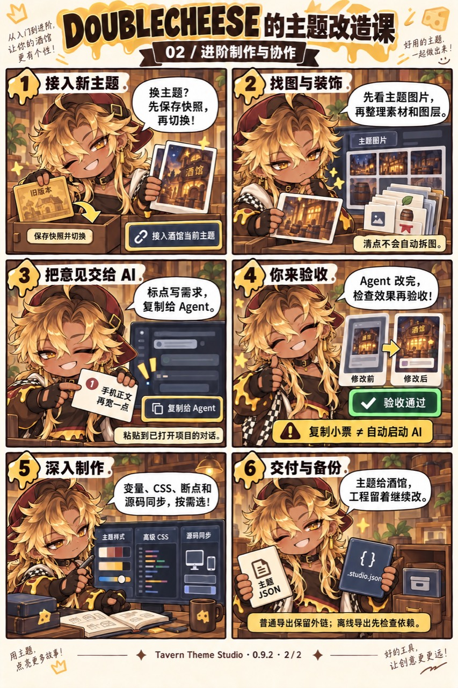

# DOUBLECHEESE 的主题改造课

跟着 DOUBLECHEESE，先完成一次主题修改，再学素材整理和 Agent 协作；想从一个想法开始设计，直接看 **[共创篇](#page-3)**。漫画画面保留 **0.9.2** 的入口与手动导入流程，下面的实际操作已更新为 **0.14.0**；入门、进阶与共创使用同一款工具。

[普通用户入门](../README.md#beginner) · [完整进阶指南](advanced-guide.md) · [从零共创指南](co-design.md)

漫画中的界面是操作示意，安装路径和完整步骤以文字说明为准。图片可以单独下载，下面也保留文字步骤，方便搜索、复制和阅读。

## 第一页 · 普通用户入门

[打开 / 保存第一页原图](assets/doublecheese/01-getting-started.jpg)

| 格子 | DOUBLECHEESE 说 | 实际操作 |
| --- | --- | --- |
| 1 · 开工准备 | 先运行工作台，再装连接器！ | 先启动酒馆，完整解压核心包，Windows 双击 `start.cmd` 并选择酒馆目录；运行环境、依赖与连接器自动准备。macOS / Linux 准备 Node.js 22+ 后运行 `npm run setup` |
| 2 · 连接真实酒馆 | 打开测试链接，确认虚构测试对话。 | 启动器自动打开设计工作台，或在酒馆扩展中点「打开设计工作台」，等待「当前为虚构测试对话」；旧 `#tts-lab` 链接自动转入 |
| 3 · 先留退路 | 保存一个版本，放心开始改！ | 平时自动保存；大改前可在「备份 → 保存 / 恢复版本」留快照 |
| 4 · 点哪改哪 | 拾取元素，调颜色、圆角和间距。 | 拾取或选择部件；同类部件共同生效。不满意用 `Ctrl+Z` |
| 5 · 电脑手机都看看 | 先调所有尺寸，再检查手机。 | 顶部「手机 / 电脑」切换真实预览视口；编辑区「所有尺寸 / 仅手机 / 仅电脑」独立决定修改范围。窄屏通过「预览 / 编辑」切换 |
| 6 · 导出才是交付 | 导出 JSON，再到酒馆导入并选择！ | 点击「应用 / 导出 → 应用到酒馆」，等「已保存并应用」；分享时下载 JSON，再到酒馆导入和选择 |

**记住：临时预览 ≠ 保存主题。** 等待「应用到酒馆」成功，或完成手动导入和选择后，关闭工作台才会保留效果；首次使用的详细安装步骤见 [README 入门路线](../README.md#beginner)。

## 第二页 · 进阶制作与协作

[打开 / 保存第二页原图](assets/doublecheese/02-advanced.jpg)

| 格子 | DOUBLECHEESE 说 | 实际操作 |
| --- | --- | --- |
| 1 · 接入新主题 | 换主题？先保存快照，再切换！ | 「作品 → 新建作品」接入酒馆当前主题或导入 JSON，核对名称后创建；切换前自动留恢复点 |
| 2 · 找图与装饰 | 先看主题图片，再整理素材和图层。 | 在「素材 → 主题图片」清点使用位置；清点不会自动拆图或创建图层 |
| 3 · 把意见交给 AI | 标点写需求，复制给 Agent。 | 标点或保存整张蓝图后，告诉当前 Agent「标好了 / 蓝图已保存」；首次或换 Agent 时再复制交接 |
| 4 · 你来验收 | Agent 改完，检查效果再验收！ | 查看变更与证据，在真实测试对话检查，再点「验收通过」 |
| 5 · 深入制作 | 变量、CSS、断点和源码同步，按需选！ | 使用「主题样式」「高级 CSS」和布局工具；有维护源码时绑定构建配方 |
| 6 · 交付与备份 | 主题给酒馆，工程留着继续改。 | 主题 JSON 用于安装；`.studio.json` 用于继续编辑。普通导出保留外链，严格离线先检查依赖 |

0.13 新增的多部件蓝图不在旧漫画画面里：进入画布 → 切到「蓝图」→ 调整多个部件 →「保存整张蓝图」。小票待 Agent 落实并验收后才进入主题；刷新前请保存草稿。见 [画布指南](canvas-mode.md)。

**记住：复制小票 ≠ 自动启动 AI。** 更完整的素材、CLI 和备份流程见 [进阶指南](advanced-guide.md)。

## 第三页 · 从零共创你的酒馆

[打开 / 保存共创篇原图](assets/doublecheese/03-co-design-v3.png)

| 格子 | DOUBLECHEESE 说 | 实际操作 |
| --- | --- | --- |
| 1 · 说个大概 | 想做暗黑童话，手机用，布局可以大改！ | 写主题想法，选电脑 / 手机和布局意愿；不确定的选项先不改，特别要求选填 |
| 2 · 直接和 Agent 聊 | 先聊就好，不用先填表。 | 直接表达想法；已有工作台时，也可以点「复制给 Agent，开始共创」带入工程信息，有参考图时另附 |
| 3 · Agent 先理解，再给图 | 先看酒馆部件，再比较不同布局！ | Agent 认识真实界面，允许大改时大胆重构，给出构图和排版不同的方向，解释手机取舍和实现方式 |
| 4 · 喜欢哪里，直接说 | 喜欢 A 的书页感，装饰再少一点。 | 在对话里表达偏好即可，不用回来重复填表；Agent 整理选中的图片版本与修改意见 |
| 5 · Agent 做出可用样板 | 样板接好了，来工作台试试！ | 大方向敲定后，Agent 尽量照图复刻阅读面板、头像、消息和输入区，用真实截图对照、修正后接入工作台；记录和技术细节由 Agent 整理 |
| 6 · 自己微调，标点迭代 | 字号自己调，难改的标给 Agent！ | 用「拾取元素」微调，用「标点评论」反馈；同一项目对话里告诉 Agent 已标好，让它读取最新工程继续改。满意后「应用到酒馆」，或下载新名称主题再原生导入 |

**记住：参考图 ≠ 验收截图，临时预览 ≠ 保存主题。** 复制提示不会启动 AI，也不自动附带图片。起步想法存在当前浏览器，Agent 另行维护设计记录；两者不会自动同步，也不包含在 `.studio.json` 中。换对话时带上 Agent 整理的记录和图片即可。没有出图工具时，可用已有参考或标明的线框继续讨论，并如实记录限制。

完整的出图提示、工程起点、选图方法和验收条件见 [从零共创指南](co-design.md)。已有选定参考或只做小修，可缩短探索过程。

主角 DOUBLECHEESE 的角色参考由用户提供。前两页采用用户修正后的图片并原样保留；共创篇以既有漫画为角色与画风参考，使用内置 imagegen 新生成。原两页图片上的 1/2、2/2 页码保留，共创篇单独标记。来源、生成提示词与检查记录见 [漫画制作记录](assets/doublecheese/GENERATION.md)。
