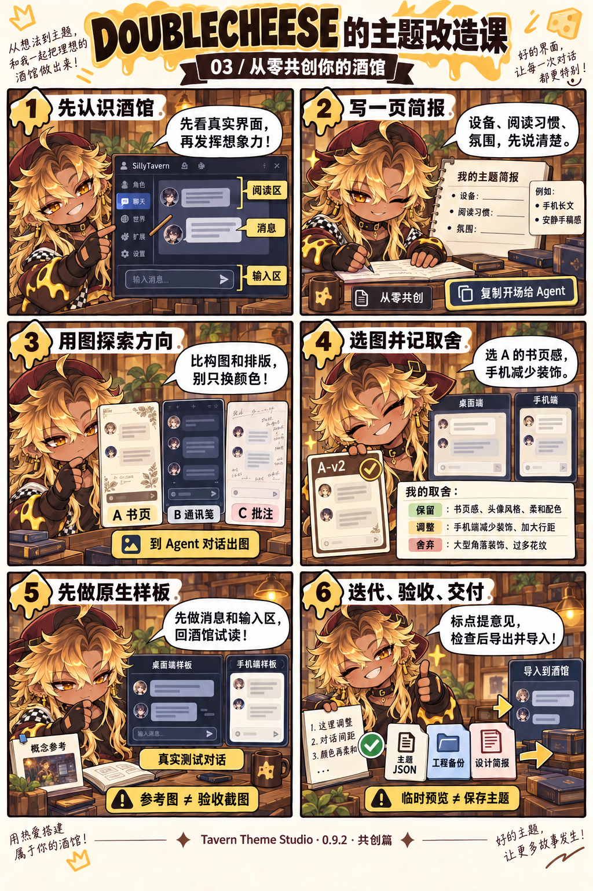

# DOUBLECHEESE 的主题改造课

跟着 DOUBLECHEESE，先完成一次主题修改，再学素材整理和 Agent 协作；想从一个想法开始设计，直接看新增的 **[共创篇](#page-3)**。三页对应工作台 **0.9.2**；入门、进阶与共创使用同一款工具。

[普通用户入门](../README.md#beginner) · [完整进阶指南](advanced-guide.md) · [从零共创指南](co-design.md)

漫画中的界面是操作示意，安装路径和完整步骤以文字说明为准。图片可以单独下载，下面也保留文字步骤，方便搜索、复制和阅读。

## 第一页 · 普通用户入门

[打开 / 保存第一页原图](assets/doublecheese/01-getting-started.jpg)

| 格子 | DOUBLECHEESE 说 | 实际操作 |
| --- | --- | --- |
| 1 · 开工准备 | 先运行工作台，再装连接器！ | 准备 Node.js 22+。核心包完整解压后运行 `start.cmd` / `npm start`；源码用户先安装依赖并打包连接器 |
| 2 · 连接真实酒馆 | 打开测试链接，确认虚构测试对话。 | 安装连接器，打开终端的 `#tts-lab` 链接，等待「当前为虚构测试对话」 |
| 3 · 先留退路 | 保存一个版本，放心开始改！ | 「保存 / 恢复版本」中保存一个修改前版本 |
| 4 · 点哪改哪 | 拾取元素，调颜色、圆角和间距。 | 拾取或选择部件；同类部件共同生效。不满意用 `Ctrl+Z` |
| 5 · 电脑手机都看看 | 先调所有尺寸，再检查手机。 | 基础样式用「所有尺寸」，窄屏覆盖用「仅手机」；真实酒馆要缩窄窗口实测 |
| 6 · 导出才是交付 | 导出 JSON，再到酒馆导入并选择！ | 使用新名称导出，再到「用户设置 → UI Theme」导入和选择 |

**记住：临时预览 ≠ 保存主题。** 导出不会自动替你在酒馆中应用主题；首次使用的详细安装步骤见 [README 入门路线](../README.md#beginner)。

## 第二页 · 进阶制作与协作

[打开 / 保存第二页原图](assets/doublecheese/02-advanced.jpg)

| 格子 | DOUBLECHEESE 说 | 实际操作 |
| --- | --- | --- |
| 1 · 接入新主题 | 换主题？先保存快照，再切换！ | 「接入酒馆当前主题」中核对名称，再「保存快照并切换」；也可导入主题 JSON |
| 2 · 找图与装饰 | 先看主题图片，再整理素材和图层。 | 在「素材 → 主题图片」清点使用位置；清点不会自动拆图或创建图层 |
| 3 · 把意见交给 AI | 标点写需求，复制给 Agent。 | 保存小票，再粘贴到已打开本项目、能访问本机工作台的 Agent 对话 |
| 4 · 你来验收 | Agent 改完，检查效果再验收！ | 查看变更与证据，在真实测试对话检查，再点「验收通过」 |
| 5 · 深入制作 | 变量、CSS、断点和源码同步，按需选！ | 使用「主题样式」「高级 CSS」和布局工具；有维护源码时绑定构建配方 |
| 6 · 交付与备份 | 主题给酒馆，工程留着继续改。 | 主题 JSON 用于安装；`.studio.json` 用于继续编辑。普通导出保留外链，严格离线先检查依赖 |

**记住：复制小票 ≠ 自动启动 AI。** 更完整的素材、CLI 和备份流程见 [进阶指南](advanced-guide.md)。

## 第三页 · 从零共创你的酒馆

[打开 / 保存共创篇原图](assets/doublecheese/03-co-design.png)

| 格子 | DOUBLECHEESE 说 | 实际操作 |
| --- | --- | --- |
| 1 · 先认识酒馆 | 先看真实界面，再发挥想象力！ | 进入虚构测试对话；结合「从零共创」里的界面地图，认识阅读区、消息、头像名字、输入区、思考栏和抽屉 |
| 2 · 写一页简报 | 设备、阅读习惯、氛围，先说清楚。 | 只说主题想法、电脑 / 手机、布局能改多大，再复制给 Agent；参考和特别要求选填，阅读习惯等细节边看图边补 |
| 3 · 用图探索方向 | 比构图和排版，别只换颜色！ | 用宿主截图认识部件与功能，按布局意愿探索 2–3 个方向，可以大改排版；比较阅读、材质、装饰与手机策略，图像工具在 Agent 对话中使用 |
| 4 · 选图并记取舍 | 选 A 的书页感，手机减少装饰。 | 记录主方向的文件名 / 版本与保留、调整、舍弃项；后续围绕具体问题迭代，已有选择不重复确认 |
| 5 · 先做原生样板 | 先做消息和输入区，回酒馆试读！ | 复制原生样板交接，先实现阅读面板、两类消息和输入区；在真实酒馆桌面 / 窄屏对照概念图，再扩展细节和素材 |
| 6 · 迭代、验收、交付 | 标点提意见，检查后导出并导入！ | 具体问题用小票，检查交互和阅读状态，导出新名称主题并原生导入；工程备份、设计简报及必要源码素材一起保留 |

**记住：参考图 ≠ 验收截图，临时预览 ≠ 保存主题。** 复制提示不会启动 AI，也不自动附带图片。简报保存在当前浏览器，需单独下载；它不包含在 `.studio.json` 中。没有出图工具时，可用已有参考或标明的线框继续讨论，并如实记录限制。

完整的出图提示、工程起点、选图方法和验收条件见 [从零共创指南](co-design.md)。已有选定参考或只做小修，可缩短探索过程。

主角 DOUBLECHEESE 的角色参考由用户提供。前两页采用用户修正后的图片并原样保留；共创篇以既有漫画为角色与画风参考，使用内置 imagegen 新生成。原两页图片上的 1/2、2/2 页码保留，共创篇单独标记。来源、生成提示词与检查记录见 [漫画制作记录](assets/doublecheese/GENERATION.md)。
