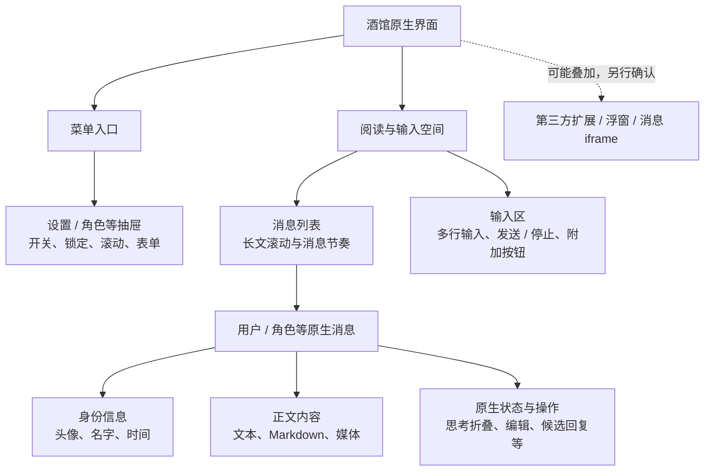

# 共创前的宿主参考

供 Agent 在提出布局和界面概念图前查阅。它随工作台打包，不依赖上级工作区安装的主题 skill。这里提供功能地图和取证方法；目标版本的源码、实际 DOM 与本次用户选择决定具体实现。

## 知识从哪里来

后续主题默认兼顾 ST 与 TT；TT 的源码入口是 `src/`，并有独立的移动布局约束，详见[双宿主主题适配](tauritavern-themes.md)。

| 来源 | 用来确认 | 不能据此声称 |
| --- | --- | --- |
| 目标安装的版本 / 提交、`public/index.html`、`public/style.css`、`public/css/mobile-styles.css`、`public/scripts/power-user.js` 与实际 DOM | 控件结构、主题字段、显隐行为、响应式条件；文件位置按版本核对 | 旧版本的选择器和数值始终有效 |
| 工作台 [TARGETS](../shared/core.js)、[连接器](../connector/bridge.js) | 工作台能定位和临时预览的部件 | 这是完整 DOM，或未列出的部件不存在 / 不可改 |
| 经确认的虚构测试画面 | 特定主题、设置、视口和状态下的表现 | 画面就是无美化的原生界面，或单张图已验证全部交互 |
| 旧作品、主题 skill 的经验、模型已有知识 | 设计提案、排错线索和候选实现 | 已了解本次宿主版本，或旧作品的视觉规则适用于新作品 |

工作台版本和连接器版本不是 SillyTavern 版本。共创提示中的工程 ID、修订号和连接状态不包含实时 DOM、截图或完整主题 CSS；按需另行读取。图像工具也不会自动读工作区，结构说明和图片必须实际传入。

## 界面地图：保留功能，按意愿重做外观

这是功能关系，不是逐节点 DOM 树，也不规定像素位置。以下选择器来自当前工作台，只作查找入口。



读图时分清两类决定：**功能关系**用于把设计落回真实控件；**视觉位置、轮廓、色彩和装饰**由本次设计决定。展开 / 隐藏的部件不一定同时出现，桌面与手机也不必采用同一种排布。

| 区域 / 定位线索 | 关系与需要保留的状态 | 可探索的外观 |
| --- | --- | --- |
| 背景、阅读面板 `#sheld`、消息列表 `#chat` | 阅读面板协调消息滚动与输入空间；检查长文、窗口高度和输入增长 | 空间组织、正文行宽、留白、背景 / 前景层次 |
| 两类消息 `#chat .mes[is_user]` | 每条消息关联身份、正文和操作；检查短文、长文及连续消息 | 书页、气泡、分栏感、消息轮廓与节奏，不强制左右气泡 |
| `.avatar`、`.name_text`、`.timestamp`、`.mes_buttons` | 头像 / 名字与消息归属清楚；操作栏保留编辑等真实入口；显隐受设置影响 | 肖像形状、内 / 外置、名字压边、层级与对齐 |
| `.mes_text` 与 Markdown | 引用、代码、表格、链接、媒体均可能占用正文空间 | 字体、行距、排版层次、长行处理；不能只对纯文本成立 |
| `.mes_reasoning_summary`、`.mes_reasoning` | 原生思考展开 / 收起与正文层级；消息编辑、swipe 另有状态 | 标题形态、主次、材质，不画出无对应实现的新功能 |
| `#send_form`、`#send_textarea` 与真实按钮 | 多行输入、发送 / 停止显隐、可能存在的快捷回复 | 按钮组织、边缘装饰、输入区比例；不强制显示隐藏按钮 |
| 顶部入口、`#left-nav-panel`、`#right-nav-panel`、实际抽屉 | 打开 / 收起、锁定、滚动、表单与焦点；真实结构按版本核验 | 面板层级、材质、密集控件排版；位置可探索但须验证实现 |

原生显示模式、隐藏头像 / 时间戳等设置可能使部件不可见，不能仅凭截图判定它被删除。第三方浮窗、快捷回复和消息 iframe 不自动成为原生主题契约。CSS 可以改变排布和装饰；跨父容器移动、新增交互等方案需核实，必要时说明扩展开发范围。不要只因现有布局熟悉就否定重排，也不要承诺概念图中任何结构都能靠 CSS 完成。

工作台「仅手机」的默认断点是 767 px，不代表宿主断点。旧案例中的 1.19.0、1000 px、根高度补丁、P5 或月弧作品的素材比例均不是新主题的默认要求。

## 当前酒馆截图可能带来什么影响

`#tts-lab` 准备虚构聊天内容，仍使用该安装的主题、原生外观设置、背景和扩展。确认虚构样本后才能观察画面；准备步骤见 [真实酒馆工作流](native-lab.md)。

当前连接器的预览会临时暂停 `#custom-style`，应用工程 CSS、部分主题变量及原生外观 class；真实宿主的页面宽度仍跟随宿主设置，其他扩展样式继续存在。关闭预览 /「查看原样」恢复的是用户原主题。它们都不是“无美化模式”。具体机制见 [样式隔离与恢复](../connector/theme-isolation.js)。

判断参考来源时，考虑这些层：宿主基础 CSS → 原生主题字段 / 外观模式 → 自定义 CSS / 背景 → 扩展样式 / 内联位置 → 工作台临时预览。只去掉其中一层不能声称已得到基础外观。工程 JSON 也不能证明浏览器当前显示了什么。

### 根据本次任务取参考

| 起点 | 主要依据 | 当前美化的作用 |
| --- | --- | --- |
| 从零、允许大改 | 功能地图、目标版本结构；需要界面参考时优先独立基础环境 | 识别部件和后续兼容检查，不默认继承色彩、素材、轮廓或坐标 |
| 改造已有美化 | 当前工程、现用主题的虚构样本、用户指定的保留项 | 是明确的改造基线；只改变本次授权部分 |
| 小修某个区域 | 对应状态的实际画面和生效规则 | 直接复现，不必先搭建全新参考环境 |

需要排除旧风格时，优先使用**同一宿主版本的独立数据 / 配置环境**，采用可确认的基础主题、虚构样本和必要连接器，不复制私人设置、角色或聊天。该环境也要确认工作台预览已关闭、相关扩展和背景的状态；独立端口本身不表示数据独立。启动方法须核对目标安装支持的参数。不要为了取参考切换用户保存的主题或全局关闭扩展。

不能准备独立环境时，仍可根据源码、DOM 和上面的功能关系制作标明用途的部件示意，先推进风格讨论；把版本、结构或状态的未知项留在记录中。现用美化的截图可以作补充证据，但标明其样式来源，不称“原生默认截图”。不额外要求用户填表或先搭好环境。

## 把参考传给图像工具

按实际附件写清用途，避免只说“照酒馆截图做一版”：

```text
本次起点：从零设计，布局允许大改。
结构依据：[目标版本的部件说明 / 独立基础环境截图 / 已标明的结构示意]。
图 A：[文件名、来源]，仅用于认识阅读区、消息身份、输入及菜单功能。
图 B：[文件名、来源]，用于[用户选定的材质 / 构图 / 色彩]。
需继承的旧主题元素：[明确列出；从零且无保留要求时填“无”]。
原图的位置和轮廓是否需要保留：[按用户要求填写]。
输出为概念探索，不是已实现界面或交互证明。
```

从零时默认不把高度风格化的旧主题全图作为主要出图附件；仅写“忽略旧风格”也可能仍被其视觉带偏。可换成结构说明、标明用途的示意或必要局部。用户要求继承旧风格时则直接使用，并明确保留范围。图像生成后的“去风格图”仍是生成示意，不能当成真实原生截图。最终样板回到真实宿主验证。

在 `design-brief.md` 简记版本依据、参考文件及用途、仍生效的外观层、用户保留项和未核验部分即可，参见[记录模板](co-design-brief.template.md)。独立环境提供结构参考，用户实际环境提供兼容证据，两者分别记录。
