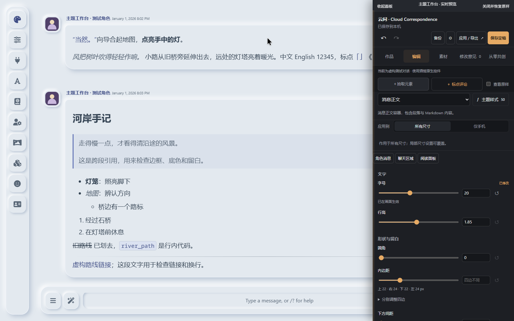
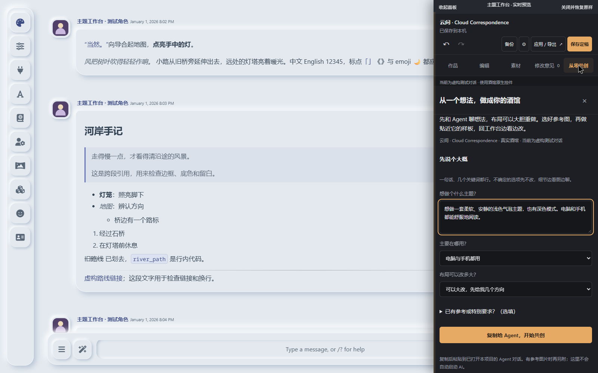
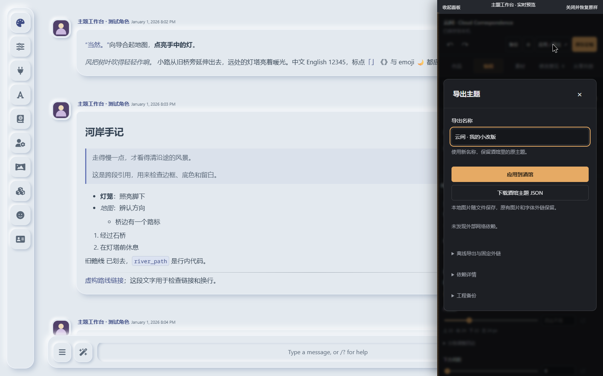

# 主题工作台 · 真实酒馆演示

以 [云间 · Cloud Correspondence](https://github.com/demilich1117/cloud-correspondence) 为例，演示部件拾取、即时微调、撤销和主题导出。截图来自专用虚构测试对话，没有私人角色或聊天。

## 拾取与微调

左侧是真实酒馆，右侧是工作台；点选消息正文后，可以调整对应部件。

## 从想法开始

从零共创入口帮助整理起步想法；之后在自己的 Agent 对话里讨论、看图和迭代。工作台不会自行启动 AI。

## 应用与分享

满意后保存为酒馆原生主题，也可以下载主题 JSON 或工程备份。

[观看或下载短视频](https://github.com/demilich1117/tavern-theme-studio/releases/download/v0.11.1/tavern-theme-studio-demo.mp4) · [Discord 发帖文字](discord-post.md) · [安装包](https://github.com/demilich1117/tavern-theme-studio/releases/tag/v0.11.1)

本次 0.11.1 是共创指南与发布资料更新；画面中的编辑、撤销、原生应用能力延续自 0.11。测试宿主为 SillyTavern 1.19.0 / `06bde939f`，手机效果由浏览器视口模拟，未代表实体手机验收。
