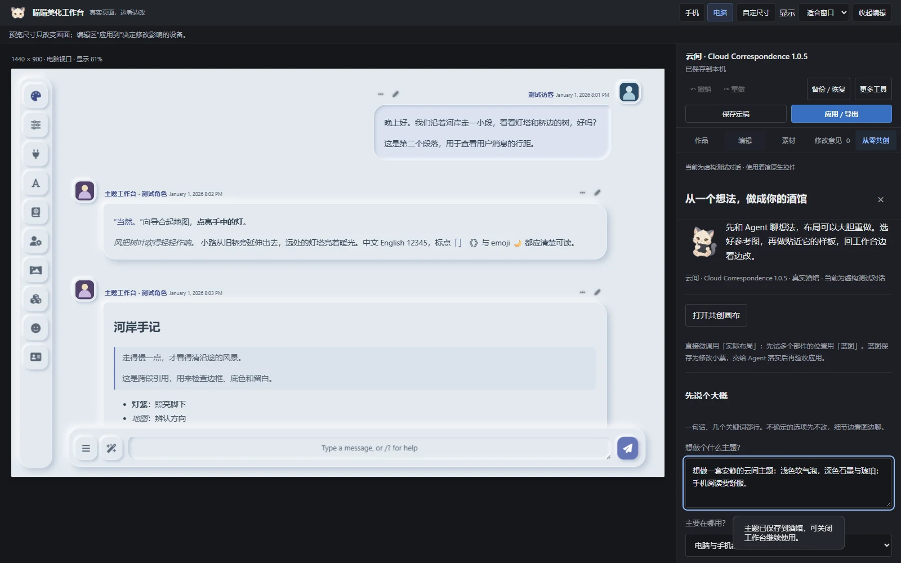
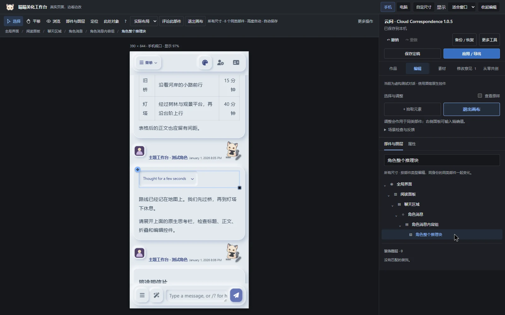
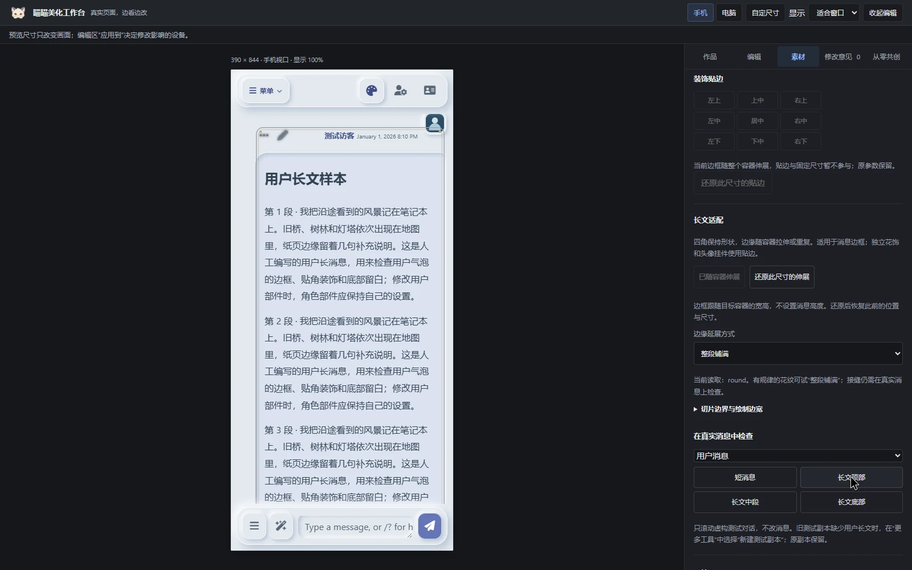
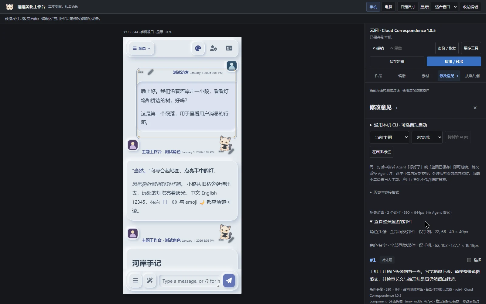
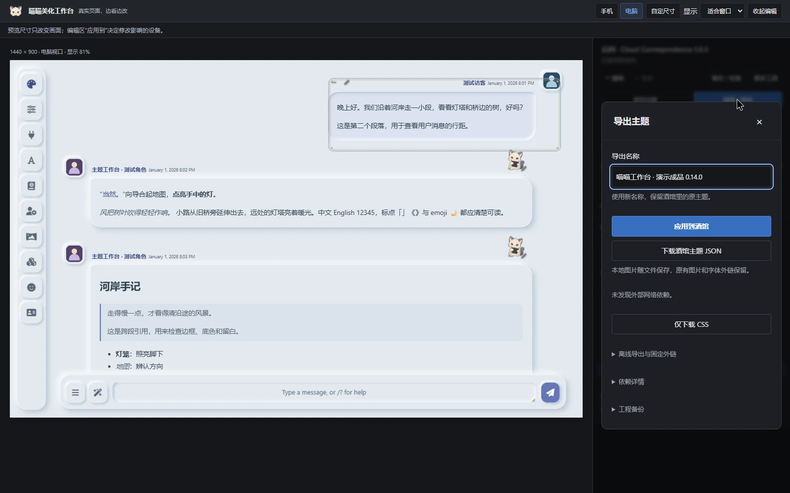

# 喵喵美化工作台 0.14.0 · 实际演示

本页截图与字幕视频来自真实 SillyTavern 1.19.0 的独立虚构测试对话，主题以云间 1.0.5 为基础。演示用猫咪挂件与细线边框只加入隔离的录制工程，不会自动添加到用户的主题。

[下载本版](https://github.com/demilich1117/tavern-theme-studio/releases/tag/v0.14.0) · [观看完整字幕视频](https://github.com/demilich1117/tavern-theme-studio/releases/download/v0.14.0/meow-studio-0.14.0-demo.mp4) · [截图与四段短片](https://github.com/demilich1117/tavern-theme-studio/releases/download/v0.14.0/meow-studio-0.14.0-showcase.zip) · [Discord 文案](discord-post.md)

## 从想法到真实画面

先和 Agent 讨论大致方向、制作样板，再在工作台拾取部件微调。顶部猫咪标识和共创入口插画之外，编辑区保持简洁。

第一段 `01-design.mp4` 演示共创入口、拾取角色正文、修改字号、撤销、手机预览与尺寸覆盖说明。工作台不自动调用模型；本视频没有模拟 Agent 回答。

## 画布与部件目录

第二段 `02-canvas.mp4` 演示用户头像独立拖动、撤销、目录搜索、整个推理块调宽和浏览模式下的原生折叠。手机视口的工具栏放在预览外，小把手保留较大的点击区域。

## 装饰与长文

第三段 `03-decoration.mp4` 演示九宫格贴边、正负边距、九切片随容器伸展，以及用户长文顶部、中段、底部和手机检查。装饰素材需先接入可调图层；普通图片不会自动变成可拖动部件。

## 蓝图交接与原生导出

第四段 `04-delivery.mp4` 演示保存多部件蓝图小票、应用已保存修改和下载酒馆主题 JSON。蓝图仍是待落实方案，交给 Agent 完成并验收后才属于正式主题。

录屏为真实浏览器操作，中文字幕已嵌入画面底部，播放无需另加载字幕。没有旁白。手机效果使用浏览器视口模拟；不代表实体手机、真实流式回复或所有扩展组合均已验证。详细证据见 [本版验证记录](validation-0.14.md)。旧版演示继续保留在 [0.11.1 Release](https://github.com/demilich1117/tavern-theme-studio/releases/tag/v0.11.1)。
